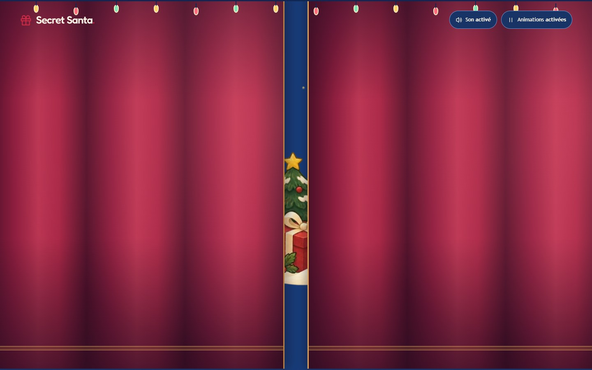
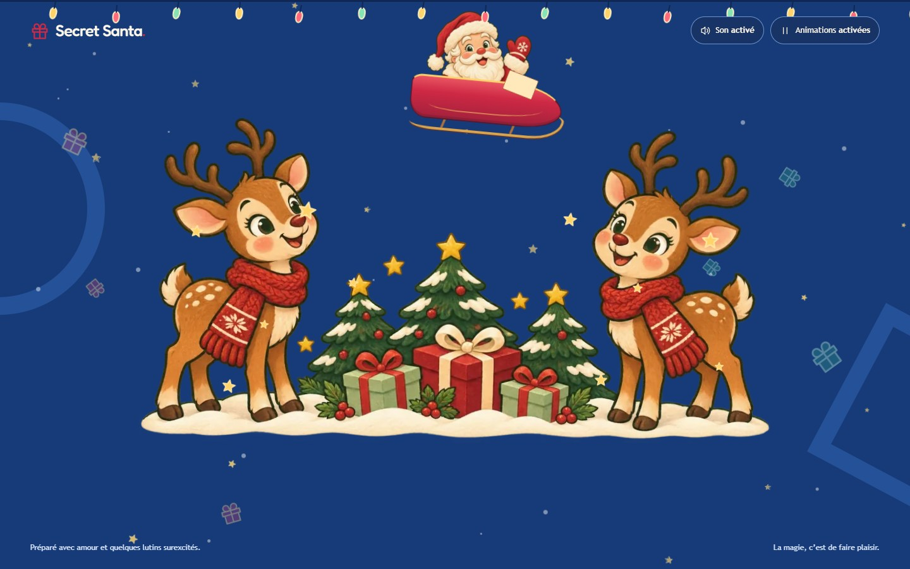
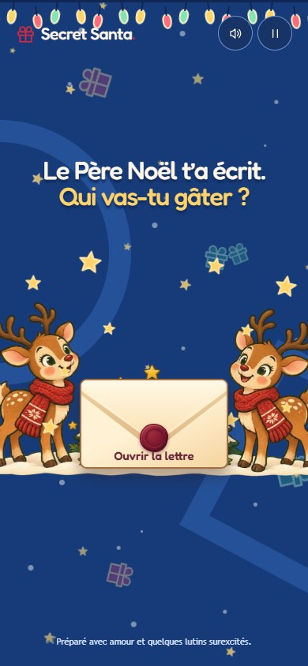
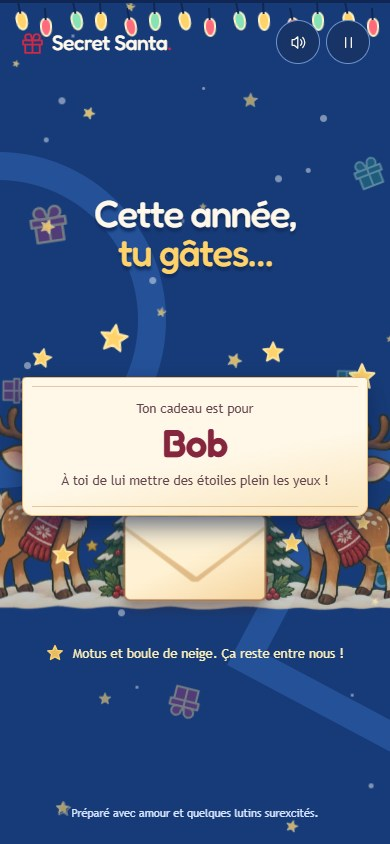

# Screenshots

The Christmas experience on desktop (1440 × 900) and mobile (390 × 844).
These captures use the fictional demo where Alice gives a gift to Bob.

## Desktop

| Closed curtain                                                   | Sleigh arrival                                       |
| ---------------------------------------------------------------- | ---------------------------------------------------- |
|  |  |

| Letter ready                                         | Recipient revealed                                                |
| ---------------------------------------------------- | ----------------------------------------------------------------- |
|  |  |

## Mobile

| Letter ready                                               | Opening the letter                                             | Recipient revealed                                      |
| ---------------------------------------------------------- | -------------------------------------------------------------- | ------------------------------------------------------- |
|  |  |  |

The opening capture is from about five seconds into the jingle. The result captures show the
settled paper after the confetti.
